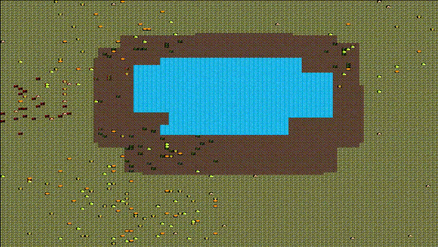

# Environmental Memory in Collective Foraging: From Individual Information Use to Shared Benefits

Environment-mediated communication provides a mechanism for indirect interaction in which cues generated through individual activities remain in a shared environment and influence the decisions of other agents. This mechanism is commonly associated with stigmergy. In this work, the environmental information supporting this interaction is represented as environmental memory (EM). However, individuals may differ in how they respond to the same environmental information, potentially leading to different outcomes at both individual and population levels. We investigate these interactions using an Agent-Based Model (ABM) of hominin foraging, in which EM emerges from traces associated with successful resource acquisition and can subsequently influence agents' movement decisions. We progressively examine homogeneous populations, introduce behavioral heterogeneity through agents with different sensitivities to EM, and finally incorporate food sharing. Our results show that greater reliance on EM does not necessarily translate into greater resource acquisition, highlighting the importance of environmental information persistence. In heterogeneous populations, agents exhibited distinct information-use strategies, with more EM-sensitive agents relying more strongly on environmental cues. When food sharing was introduced, these agents also contributed more surplus resources to the shared pool, while the resulting benefits extended to agents that relied less strongly on EM. Redistribution increased population-level caloric intake and reduced the mean caloric gap between behavioral strategies. The collective value of environmental memory therefore depends not only on how environmental information persists and is exploited, but also on the social mechanisms through which resources acquired from its use are redistributed.

# Simulation example



## Visualization controls

While the simulation window is open, press the **Spacebar** to see the visualization of environmental memory (EM).


# Hominin Foraging Model

This project runs an agent-based model of hominin foraging. The simulation is executed through `run_debug.py`, which receives the experiment configuration as positional arguments in the terminal.

## Requirements

- Python `3`
- Mesa `2.3.4`
- Pygame `2.6.1`

With the virtual environment activated, install the Python dependencies with:

```bash
python -m pip install "mesa==2.4.0" pygame
```

## Running a simulation

The script expects **12 positional arguments**, in this exact order:

```text
days_to_run clockDay evaporation followers explorers plantsA plantsB plantsC plantsD nests hyenas crocodiles
```

Example:

```bash
python3 run_debug.py 90 720 10 10 10 50 50 50 50 20 0 0 > output.txt
```

This command runs the model for 90 days and saves its standard output to `output.txt`.


## Parameters

| Position | Variable | Description | Example |
| --- | --- | --- | --- |
| 1 | `days_to_run` | Number of simulated days. | `90` |
| 2 | `clockDay` | Number of simulation clock steps per day. | `720` |
| 3 | `evaporation` | Pheromone evaporation parameter used by the model. | `10` |
| 4 | `followers` | Initial number of Follower hominins. | `10` |
| 5 | `explorers` | Initial number of Explorer hominins. | `10` |
| 6 | `plantsA` | Initial number of plant resources of type A. | `50` |
| 7 | `plantsB` | Initial number of plant resources of type B. | `50` |
| 8 | `plantsC` | Initial number of plant resources of type C. | `50` |
| 9 | `plantsD` | Initial number of plant resources of type D. | `50` |
| 10 | `nests` | Initial number of nests. | `20` |
| 11 | `hyenas` | Initial number of hyenas. Use `0` to disable them. | `0` |
| 12 | `crocodiles` | Initial number of crocodiles. Use `0` to disable them. | `0` |

The default map path and grid dimensions are currently defined in `run_debug.py`:

```python
HominidsModel(10, 10, path="MapsCsv/basicMapWaterHole100x100.csv", ...)
```

## Example

```bash
python3 run_debug.py 90 720 10 10 10 50 50 50 50 20 0 0
```
